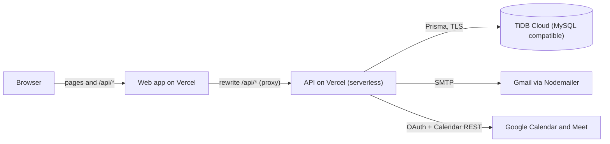
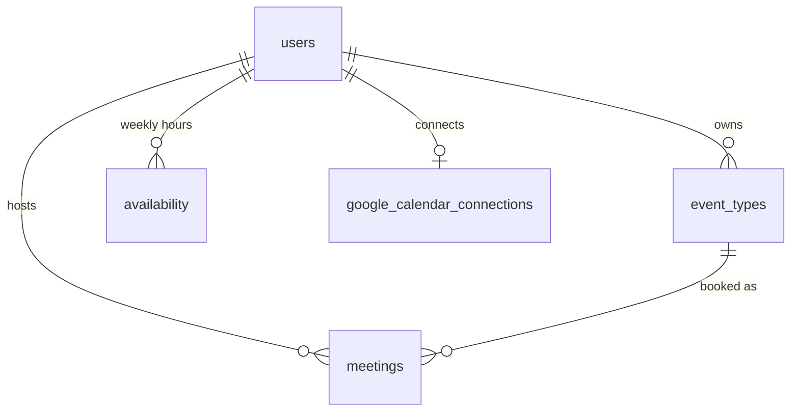
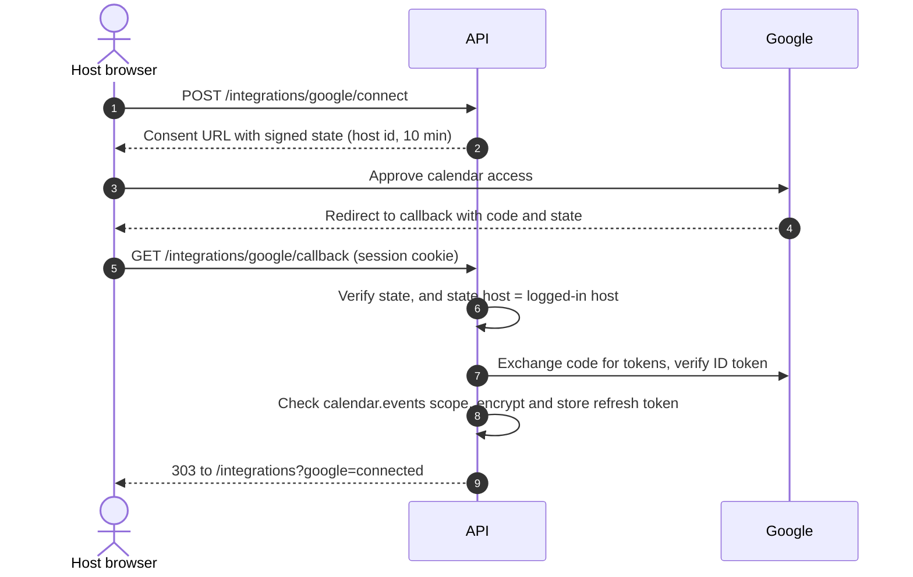

# Architecture

How the Calendly clone is built: the monorepo, the request path through the API,
the data model, login and security, and the Google Calendar and email
integrations.



The browser only ever talks to the web domain. The web project forwards `/api/*`
to the API project, so there is no CORS and the login cookie stays first-party.

## 1. Modular Monolith

The system is a pnpm monorepo with three packages:

| Package           | What it is                                                         | Main libraries                                                                              |
| ----------------- | ------------------------------------------------------------------ | ------------------------------------------------------------------------------------------- |
| `apps/web`        | Single-page app: host dashboard, login and signup, booking pages   | React 18, Vite, TanStack Router (file routes), TanStack Query, Zustand, Tailwind, shadcn/ui |
| `apps/server`     | REST API under `/api/v1`, one deployable                           | Express 4, Prisma 6, Zod, jsonwebtoken, bcrypt, Nodemailer, google-auth-library, winston    |
| `packages/shared` | Contracts used by both: Zod schemas, types, endpoints, error codes | Zod                                                                                         |

The server is a **single deployable monolith** organized **by feature module**,
not by technical layer. One codebase, one deploy, but with hard internal seams
so a module could later be extracted into a service without rewrites.

```
apps/server/src/modules/<feature>/
  ├─ <feature>.routes.ts       # route table + validation middleware
  ├─ <feature>.controller.ts   # HTTP boundary (req/res only)
  ├─ <feature>.service.ts      # business logic + invariants
  ├─ <feature>.repository.ts   # data access (the only Prisma consumer)
  └─ <feature>.mapper.ts       # entity → DTO mapping (where needed)

apps/web/src/modules/<feature>/
  ├─ pages/        # route-level screens
  ├─ components/   # feature-scoped UI
  ├─ hooks/        # TanStack Query hooks
  ├─ services/     # typed API calls
  └─ schemas/      # form schemas (Zod)

apps/web/src/routes/   # file-based routes (TanStack Router), one file per URL
```

Server modules: `auth`, `event-types`, `availability`, `bookings`, `meetings`,
`invitations`, `integrations`, `health`. Web modules mirror them.

### Why this shape?

- **High cohesion, low coupling**: everything about "meetings" lives in one
  folder. Cross-module imports are rare and explicit.
- **Parallelizable**: teams own modules end-to-end.
- **Extractable**: each backend module already has its own controller →
  service → repository chain, the natural boundary for a future microservice.

## 2. Backend: Clean Architecture + SOLID

The dependency direction is strictly inward:

```
Route → Controller → Service → Repository → Prisma
                       │
                       └── depends on @calendly/shared (schemas/DTOs)
```

- **Controller**: translates HTTP ↔ domain. No business rules.
- **Service**: owns invariants (unique slug, "already cancelled", double-book
  guard, duplicate email at signup). Depends on a repository **abstraction**,
  injected via the constructor (Dependency Inversion), which makes it
  unit-testable with a fake repo.
- **Repository**: the single place that knows Prisma. Swapping the ORM touches
  only this layer.
- **Mapper**: converts Prisma rows (Dates, enums) into the wire DTOs defined in
  `@calendly/shared`, keeping persistence types (and secrets such as password
  hashes) from leaking to the client.

Cross-cutting concerns are middleware, applied in this order in `app.ts`:

1. `helmet`, `cors` (allow-list from `CORS_ORIGINS`, credentials on),
   `compression`.
2. `express.json` (1 MB limit), `express.urlencoded`, `cookieParser`.
3. `request-context`: correlation id on every request and response.
4. `request-logger`: structured Winston access logs.
5. `csrf-guard`: POST, PUT and DELETE must carry
   `X-Requested-With: XMLHttpRequest`.
6. The API router. Per route: `validate(schema, part)` (Zod validation for
   body, query or params) and, for host-only routes, `require-auth`.
7. `error-handler`: normalizes `AppError`, Prisma errors (P2002 → 409,
   P2025 → 404) and unknowns into the standard `ApiError` envelope.

### Routes

| Mount                   | Access                          | Purpose                                             |
| ----------------------- | ------------------------------- | --------------------------------------------------- |
| `/health`               | Public                          | Liveness and database check                         |
| `/auth`                 | Public, except `/me`            | Signup, login, logout, current host                 |
| `/book/:username/:slug` | Public                          | Event details, free slots, create booking           |
| `/events`               | Host                            | Event types CRUD                                    |
| `/availability`         | Host                            | Weekly hours                                        |
| `/meetings`             | Host                            | List, cancel                                        |
| `/invitations`          | Host                            | Email the booking link to invitees (Send mail page) |
| `/integrations/google`  | Host, except the OAuth callback | Connect, status, disconnect Google Calendar         |

Host-only routes sit behind `require-auth`, which loads the logged-in host into
`res.locals.host`; controllers read it with `getCurrentHost(res)`. Every lookup
is scoped to that host's id, so a foreign id answers 404, the same as a missing
one.

### API Response Standardization

Every endpoint returns `ApiResponse<T>`:

```ts
type ApiResponse<T> =
  | { success: true; data: T; meta: ApiMeta }
  | { success: false; error: ApiErrorBody; meta: ApiMeta };
```

The frontend's typed API layer (`lib/api-client.ts`) unwraps this envelope and
throws a normalized `ApiRequestError`, so call sites only ever see `T`.

## 3. Database Design

Tables: `users`, `event_types`, `availability`, `meetings`,
`google_calendar_connections` (Prisma models map to these via `@@map`).



Highlights:

- **Primary keys**: `cuid()` strings: collision-resistant, sortable-ish, safe
  to expose in URLs.
- **Foreign keys**: `event_types.user_id`, `availability.user_id`,
  `meetings.event_type_id`/`host_id`, `google_calendar_connections.user_id`,
  all `onDelete: Cascade`.
- **Unique constraints**: `users.email`, `users.username`,
  `(event_types.user_id, slug)` so public links never collide per host,
  `google_calendar_connections.user_id` (one connection per host).
- **Users**: `password` holds a bcrypt hash; `username` forms the public link
  `/book/{username}/{slug}`; `timezone` is where weekly hours are interpreted.
- **Meetings**: `meet_url` and `google_event_id` are set when the host has
  Google Calendar connected.
- **Soft delete**: `deleted_at` on `users` and `event_types`; queries filter
  `deletedAt: null`, preserving FK integrity for historic meetings.
- **Audit timestamps**: `created_at` / `updated_at` everywhere.
- **Indexes** chosen for hot paths: `(host_id, start_time)`,
  `(host_id, status, start_time)`, `(event_type_id, start_time)`,
  `(user_id, is_active)`.

Migrations live in `apps/server/prisma/migrations` and are applied with
`prisma migrate deploy`.

### Double-Booking Prevention (DB-enforced)

`meetings.booking_slot_key` is a **unique** column set to `"{hostId}:{startISO}"`
while a meeting is `confirmed`, and `NULL` on cancellation. Because MySQL allows
multiple `NULL`s in a unique index:

- Two concurrent bookings for the same host+time → the second hits the unique
  violation (Prisma `P2002`) → mapped to a `409 DOUBLE_BOOKING`.
- A cancelled slot frees up (`key → NULL`) and can be rebooked.

This pushes the correctness guarantee into the database rather than relying on
read-then-write application checks that race under load.

## 4. Frontend Architecture

- **Atomic-ish layering**: `components/ui/*` (shadcn primitives) →
  `components/common/*` & `components/layout/*` (composites) → `modules/*`
  (feature screens).
- **Routing**: TanStack Router with **file-based** routes in `src/routes`.
  `routeTree.gen.ts` is generated by `tsr generate` (also run by `build` and
  `typecheck`) and is committed, as TanStack recommends. Two pathless layouts
  (`_dashboard`, `_public`) separate the host shell from the public booking
  pages.
- **Route guard**: `_dashboard`'s `beforeLoad` loads the current host and
  redirects to `/login?redirect=…` without a session. Only same-app paths are
  accepted as redirect targets.
- **Server state**: TanStack Query is the only copy of server data. A central
  `queryKeys` factory prevents key drift; retry policy skips 4xx. Mutations
  invalidate by key and surface toasts.
- **Client state**: Zustand (`ui-store` for theme, sidebar and the mobile nav
  drawer; a small store to carry the booking confirmation to the success
  screen).
- **API client**: one Axios instance with `withCredentials` and the CSRF
  header. A 401 outside `/auth/*` clears the session and returns to login.
- **Forms**: React Hook Form + Zod resolver, with shadcn `Form` primitives.
- **Resilience**: a top-level `ErrorBoundary` plus per-layout `Suspense`
  fallbacks; skeletons, empty states, and error states for every data view.
- **Responsive**: works down to phone width; navigation moves into a slide-in
  drawer below the `md` breakpoint.
- **Theming**: CSS variables (Calendly-blue palette) with light and dark
  themes. First visit follows the device setting; a script in `index.html`
  applies the saved choice before the first paint, so there is no white flash.

## 5. Shared Package as the Contract

`@calendly/shared` exports Zod schemas + inferred types + endpoint builders.
Defining a schema once gives us: server request validation, the server's
response types, the client's response types, **and** the client's form
schemas, eliminating contract drift between front and back.

## 6. Login and Security

- **Accounts**: hosts sign up with email and password. Invitees never log in;
  they book from the public link with a name and email.
- **Passwords**: bcrypt, 10 rounds. Login compares against a dummy hash when
  the email is unknown, so timing doesn't reveal which emails have accounts.
- **Sessions**: a signed JWT (HS256, 7 days) in the httpOnly cookie
  `calendly_session`. Every token names its purpose in `aud`
  (`calendly:session`), so a token signed for something else, such as the
  Google OAuth `state`, is never accepted as a login.
- **Cookie flags**: `SameSite=Lax` locally; `Secure` + `SameSite=None` in
  production.
- **CSRF**: writes need the `X-Requested-With` header, which a form on another
  site cannot send.
- **Signup**: generates the username from the email (`jane.doe@x.com` →
  `jane-doe`, with a random suffix if taken) and creates Monday to Friday,
  09:00 to 17:00 availability in the host's browser timezone, in one
  transaction.

Code: `modules/auth/*`, `shared/auth/session.ts`,
`shared/middleware/require-auth.ts`, `shared/middleware/csrf-guard.ts`.

## 7. Google Calendar Integration

Each host connects their own Google account once. From then on, every booking
creates an event on that host's Google Calendar with its own Google Meet link,
and the link goes into both confirmation emails.

| File                                             | Role                                                                                                               |
| ------------------------------------------------ | ------------------------------------------------------------------------------------------------------------------ |
| `modules/integrations/google.client.ts`          | Thin wrapper over Google: consent URL, code exchange, ID-token check, create/delete events, revoke. 10 s timeouts. |
| `modules/integrations/integration.service.ts`    | Rules: who may connect, what to store, what to do when Google fails                                                |
| `modules/integrations/integration.repository.ts` | Reads and writes `google_calendar_connections`                                                                     |
| `shared/crypto/secret-box.ts`                    | AES-256-GCM encryption of the stored refresh token (key derived from `JWT_SECRET`)                                 |

### Connecting (OAuth 2.0)



The consent URL asks for `openid`, `email` and `calendar.events` with
`access_type=offline` and `prompt=consent`, so Google always returns a refresh
token. The callback never shows an error page; every outcome becomes a result
code the Integrations page explains:

| Result             | When                                                                                                          |
| ------------------ | ------------------------------------------------------------------------------------------------------------- |
| `connected`        | Token stored                                                                                                  |
| `denied`           | The host cancelled on Google's screen                                                                         |
| `missing_scope`    | The calendar permission was unticked; the grant is revoked again                                              |
| `session_mismatch` | The browser finishing the flow isn't logged in as the host who started it (stops calendar-attachment attacks) |
| `error`            | Forged or expired state, or Google rejected the code                                                          |

### Booking creates the Meet link

1. The meeting row is saved first (so a Google outage never loses a booking).
2. `events.insert` on the host's primary calendar with
   `conferenceDataVersion=1`, `sendUpdates=none`, the invitee as a guest and
   `requestId` = meeting id (idempotent Meet creation).
3. The returned `hangoutLink` and event id are saved on the meeting as
   `meet_url` and `google_event_id`.
4. Both booking emails include the link. If Google failed, there is no link
   and the emails say the host will send the meeting details.

`sendUpdates=none` stops Google sending its own invitation, so invitees don't
get two emails.

### Cancel, disconnect, failures

- **Cancel**: deletes the calendar event; Google's 404/410 counts as already
  gone.
- **Disconnect**: deletes the stored connection and revokes the token at Google.
- **Access revoked by the host in Google** (`invalid_grant`): the connection is
  deleted and the host shows as disconnected.
- **`JWT_SECRET` changed**: stored tokens can't be decrypted; those hosts are
  disconnected and must reconnect.

Google's limits: while the OAuth app is in Testing, only listed test users can
connect and access expires after 7 days. Publishing removes the 7-day limit;
until Google verifies the app (own domain, privacy policy, demo video), users
see an "unverified app" warning and at most 100 accounts can connect.

## 8. Email (Nodemailer)

All email goes through `shared/email/email.service.ts`, using Nodemailer's Gmail
transport authenticated with `EMAIL_USER` and a Gmail **app password** in
`EMAIL_PASS`. Without them, sending is skipped and logged; nothing else breaks.

How a send works:

1. A service calls a named function, e.g. `sendBookingEmails(...)`.
2. It builds each message (subject, text and HTML) from a template.
3. `deliver()` creates the transporter on first use and sends every message
   independently with `Promise.allSettled`.
4. Failures are logged with the email kind and never thrown, so a mail outage
   can't turn a saved booking into an error. `deliver()` returns one boolean
   per message for callers that need it.

| Email             | Sent when           | To                     | Replies go to |
| ----------------- | ------------------- | ---------------------- | ------------- |
| Welcome           | A host signs up     | Host                   | sender        |
| New event         | An invitee books    | Host                   | Invitee       |
| Booking confirmed | An invitee books    | Invitee                | Host          |
| Meeting cancelled | The host cancels    | Invitee                | Host          |
| Cancellation copy | The host cancels    | Host                   | sender        |
| Invitation        | Host uses Send mail | Each invitee, one each | Host          |

Booking emails carry the Google Meet link and a "Join Google Meet" button when
one exists; times are shown in each recipient's own timezone.

Templates (`booking-notification`, `booking-confirmation`, `meeting-cancelled`,
`welcome`, `invitation`) share building blocks from `email-layout.ts`. Every
value passes through `escapeHtml`, because names, notes and messages are typed
by strangers on a public page.

The Send mail page (`POST /invitations`) is the one place email reports back: it
takes an event type, 1 to 20 addresses and an optional note, checks the event
type belongs to the host and is on, removes duplicates, sends one email per
person, and returns which addresses were `sent` and which `failed`. Without
email configured it answers 503.

Known limits: emails are sent during the request (adds latency); there is no
retry queue; personal Gmail accounts can send roughly 500 emails a day.

## 9. Configuration

The server validates its settings once at startup (`config/env.ts`) and refuses
to start with a message naming the bad variable.

| Variable                                                          | Required      | Notes                                                                            |
| ----------------------------------------------------------------- | ------------- | -------------------------------------------------------------------------------- |
| `DATABASE_URL`                                                    | Yes           | For TiDB add `sslaccept=strict`; on Vercel add `connection_limit=1`              |
| `JWT_SECRET`                                                      | In production | 32+ characters; signs sessions and derives the token encryption key. Keep fixed. |
| `NODE_ENV`                                                        | No            | `development` locally, `production` on Vercel                                    |
| `WEB_APP_URL`                                                     | Recommended   | Links in emails and the Google redirect back                                     |
| `CORS_ORIGINS`                                                    | No            | Comma-separated allow-list                                                       |
| `EMAIL_USER`, `EMAIL_PASS`                                        | For email     | Gmail address and app password                                                   |
| `GOOGLE_CLIENT_ID`, `GOOGLE_CLIENT_SECRET`, `GOOGLE_REDIRECT_URI` | For Meet      | All three or none; the redirect URI must also be listed in Google Cloud          |

## 10. Deployment

| Environment | Web                                                       | API                                                     | Database                    |
| ----------- | --------------------------------------------------------- | ------------------------------------------------------- | --------------------------- |
| Local       | Vite on `:5173`, proxies `/api`                           | `tsx watch` on `:4000`                                  | Docker MySQL (`pnpm db:up`) |
| Production  | Vercel static site; `vercel.json` rewrites `/api/*` → API | Vercel serverless function (`apps/server/api/index.ts`) | TiDB Cloud Starter          |

Release checklist:

1. Apply new migrations to production:
   `DATABASE_URL="…" pnpm --filter @calendly/server prisma:deploy`
2. Push to `main`; Vercel rebuilds both projects.
3. Open `/api/v1/health` on the web domain and expect `"success": true`.

The web and API live on different `vercel.app` addresses, which browsers treat
as different sites. Forwarding `/api` through the web domain keeps the login
cookie first-party, so Safari and strict privacy settings don't block login.
